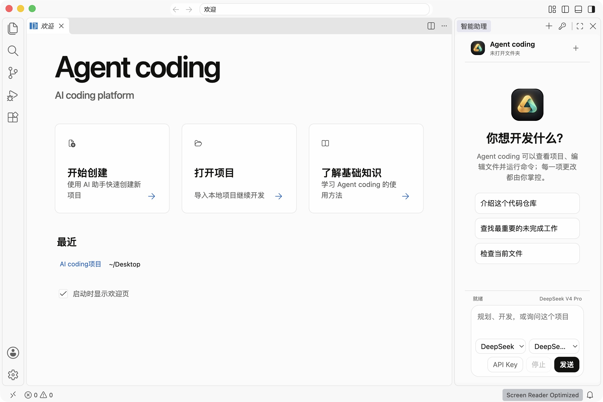

# Agent coding

**AI coding platform**

Agent coding 是一个面向企业与开发团队的桌面 AI 编程平台。产品以成熟的代码编辑器为主画布，在右侧集成常驻的多模型 Agent 工作台，让模型能够理解项目、编辑文件、运行命令，并在关键写操作前请求用户确认。



## 当前能力

- 中文桌面界面与独立的 Agent coding 品牌
- 右侧常驻 Agent 工作台
- 支持 DeepSeek、OpenAI、Anthropic、Google Gemini、OpenRouter
- 支持自定义 OpenAI 兼容接口
- 项目读取、代码搜索、文件编辑与命令执行
- 工具执行记录默认折叠，优先展示最终答案
- API Key 使用系统安全存储
- 可用于离线或企业内网构建

## 本地开发

请使用 `.nvmrc` 指定的 Node.js 版本。

```bash
npm install
npm run watch
./scripts/code.sh
```

更多产品与开发说明见 [AGENT_CODING.md](AGENT_CODING.md) 和 [PRODUCT.md](PRODUCT.md)。

## 构建 macOS 应用

```bash
npm run build-fast -- --client-only
npm run gulp -- compile-local-extensions-build compile-extension-media-build
node --experimental-strip-types build/next/index.ts bundle --nls --out out-vscode
npm run gulp -- vscode-darwin-arm64-ci
```

## 开源基础与许可

本项目基于 Code - OSS，并保留上游 MIT 许可与版权声明。上游项目说明见 [UPSTREAM_README.md](UPSTREAM_README.md)，许可条款见 [LICENSE.txt](LICENSE.txt)。
